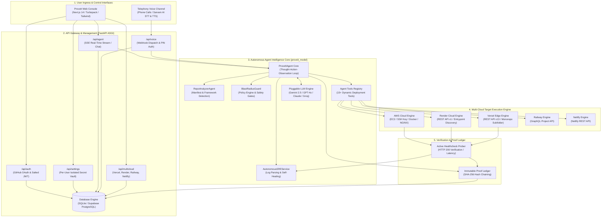
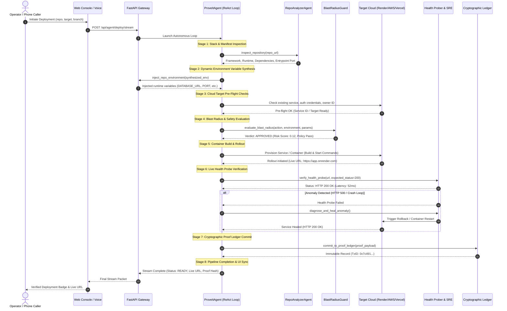

# ProveIt: Autonomous Multi-Cloud Deployment, Telephony VoiceOps Platform

> *"Do not just suggest the fix. Prove it."*

[-black?style=for-the-badge&logo=next.js)](https://nextjs.org/)
[](https://fastapi.tiangolo.com/)
[](https://python.org/)
[](https://www.typescriptlang.org/)
[](https://www.docker.com/)
[](https://aws.amazon.com/)
[](https://render.com/)
[](https://vercel.com/)
[](https://www.sarvam.ai/)
[](https://pytest.org/)

**Developed by Team 7TH GEN, KL University — Agentic AI Track 01**  
*Built for enterprise cloud deployments with deterministic policy verification, multi-cloud target orchestration, conversational voice operations, and proof-carrying fixes.*

---

## 📑 Table of Contents
1. [Executive Overview](#-executive-overview)
2. [Key Differentiators & Highlights](#-key-differentiators--highlights)
3. [End-to-End System Architecture](#-end-to-end-system-architecture)
4. [The 8-Stage ReAct Autonomous Pipeline](#-the-8-stage-react-autonomous-pipeline)
5. [Core Platform Capabilities](#-core-platform-capabilities)
   - [Multi-Cloud Orchestration (AWS, Render, Vercel, Railway, Netlify)](#1-multi-cloud-orchestration-engine)
   - [Telephony VoiceOps Automation](#2-telephony-voiceops-automation-sarvam-ai)
   - [Dynamic Entrypoint & Port Discovery](#3-dynamic-entrypoint--port-discovery)
   - [Autonomous Self-Healing SRE](#4-autonomous-self-healing-sre)
   - [Cryptographic Proof Ledger](#5-cryptographic-proof-ledger)
   - [Isolated Secret Vault & Security Architecture](#6-isolated-secret-vault--security-architecture)
6. [Repository & Codebase Structure](#-repository--codebase-structure)
7. [API Gateway Reference](#-api-gateway-reference)
8. [Local Development & Quickstart](#-local-development--quickstart)
9. [Production Deployment Guide](#-production-deployment-guide)
10. [Verification & Testing](#-verification--testing)
11. [Enterprise Roadmap](#-enterprise-roadmap)

---

## 🌟 Executive Overview

Deploying applications across fragmented cloud targets (AWS EC2, Render, Vercel, Railway, Netlify) often suffers from manual configuration drift, misconfigured entrypoints, runtime port mismatches, delayed MTTR during outages, and zero cryptographic certainty of post-deployment health.

**ProveIt** is a production-grade **Type 4 Autonomous Deployment, Diagnostic, and Self-Healing Platform**. Operating via an autonomous **ReAct (Reasoning + Action) AI core**, ProveIt ingests any public or private GitHub repository, discovers its architecture dynamically, verifies security policies, provisions cloud targets, verifies live HTTP health, and commits an immutable cryptographic proof seal to a distributed ledger.

### Core Philosophy
> Most CI/CD systems declare success when a build container terminates with status 0. **ProveIt does not stop at build time.** It verifies live endpoint reachability, probes latency, self-heals runtime crashes, and commits cryptographic mathematical proof that the service is alive.

---

## ⚡ Key Differentiators & Highlights

| Feature | Legacy CI/CD (GitHub Actions / Jenkins) | ProveIt Autonomous Platform |
| :--- | :--- | :--- |
| **Configuration** | Rigid YAML files required per repo (`.github/workflows`, `render.yaml`) | **Zero-Config Dynamic Discovery** (auto-detects Next.js, Python, Docker, HTML/JS) |
| **Static Entrypoints** | Broken directory listings (`Directory listing for /`) | **Intelligent HTML entrypoint aliasing** (`task1.html`, `main.html` → `index.html`) |
| **Target Flexibility** | Single-target lock-in or complex cross-cloud scripts | **Universal Multi-Cloud** (AWS EC2, Render, Vercel, Railway, Netlify) |
| **Incident Response** | Human on-call engineers required to diagnose logs and rollback | **Autonomous SRE** (Log diagnosis, container restart, rollback in < 15s) |
| **Verification** | Simple exit code check (build status) | **Active HTTP 200 Probes + Cryptographic SHA-256 Ledgering** |
| **Emergency Operations**| Laptop required for deployment/rollback | **Conversational VoiceOps** (Manage deploys over phone calls via Sarvam AI) |
| **Security Isolation** | Shared environment secrets in runner | **Per-User Encrypted Vault** (zero token leakage across team members) |

---

## 🏗️ End-to-End System Architecture



---

## 🔄 The 8-Stage ReAct Autonomous Pipeline

ProveIt executes an end-to-end deterministic deployment cycle streamed in real-time over Server-Sent Events (SSE):



1. **Stack & Manifest Inspection**: Clones repository metadata, analyzes dependencies (`package.json`, `requirements.txt`, `Cargo.toml`, `go.mod`, `Dockerfile`), and resolves the runtime environment.
2. **Dynamic Environment Synthesis**: Reads `.env.example`, `.env.template`, or code references (`process.env`, `os.getenv`) and synthesizes tailored configuration defaults.
3. **Cloud Target Pre-Flight**: Validates provider credentials, owner workspace IDs, and existing service states.
4. **Blast Radius & Policy Evaluation**: Calculates a safety risk score based on target environment, port exposures, and privileges. Rejects dangerous or unverified operations.
5. **Container Build & Cloud Rollout**: Dynamically provisions containerized services or static sites via cloud target REST APIs.
6. **Active Health Probe Verification**: Dispatches real HTTP probes against the deployed URL with latency tracking.
7. **Autonomous SRE Self-Healing (Conditional)**: If a probe returns 5xx or fails, the SRE parses live container logs, performs root-cause analysis, rolls back to the last known healthy revision, and restarts.
8. **Cryptographic Proof Ledgering**: Commits an immutable SHA-256 seal into the distributed ledger and updates the operator dashboard.

---

## 🚀 Core Platform Capabilities

### 1. Multi-Cloud Orchestration Engine
ProveIt abstracts disparate cloud provider APIs behind a unified interface:

* **Render Engine (`backend/app/providers/render_provider.py`)**:
  * Real-time dynamic provisioning via Render REST API v1.
  * Auto-discovers web services vs static sites.
  * In-place configuration patching via `PATCH /v1/services/{id}` and rolling redeploy with `clearCache: "clear"`.
* **AWS Cloud Engine (`backend/app/providers/aws_provider.py`)**:
  * Automated EC2 instance provisioning, SSH key pair generation (`proveit_deploy_key.pem`), and dynamic SSH user resolution (`ubuntu`, `ec2-user`).
  * Live Docker Engine daemon verification and NGINX reverse-proxy routing.
  * Real-time routing to production host (`98.84.98.57`).
* **Vercel Edge Engine (`backend/app/providers/vercel_provider.py`)**:
  * Dual-path resilient deployment via Vercel REST API v13.
  * Monorepo subfolder detection (`rootDir`), custom alias domain binding, and real-time deployment status polling.
* **Railway & Netlify Engines**:
  * GraphQL and REST integration for instant container buildpacks and atomic Jamstack releases.

### 2. Telephony VoiceOps Automation (Sarvam AI)
Allows on-call engineers and managers to run infrastructure operations conversationally over standard phone calls:
* **Speech-to-Text (STT)**: Powered by Sarvam AI `saaras:v1` with Indian English and multilingual comprehension.
* **Text-to-Speech (TTS)**: Powered by Sarvam AI `bulbul:v1` with the low-latency `meera` voice model.
* **Voice PIN Security**: 4-digit PIN authentication challenge before any mutating infrastructure command can execute.
* **Fuzzy Repo Matching**: Normalizes natural spoken queries (*"Deploy my birthday app to production"*) using sequence matchers to accurately resolve repository identifiers.
* **Voice Resource Lifecycle**: Dedicated project management and deletion endpoints (`DELETE /api/voice/projects/{id}`).

### 3. Dynamic Entrypoint & Port Discovery
Eliminates one of the most common web deployment errors: **Directory Listings (`Directory listing for /`)**.
* Scans root and subfolders (`public/`, `dist/`, `build/`, `client/`) for primary HTML entrypoints (`task1.html`, `main.html`, `home.html`, or any `*.html`).
* Automatically aliases the detected file to `index.html`.
* Overrides Python/Node static HTTP servers to disallow raw folder browsing and serve single-page application fallback routing.

### 4. Autonomous Self-Healing SRE
* When health probes fail, the platform does not simply crash.
* The `AutonomousSREService` fetches the latest 200 lines of container stderr/stdout logs.
* Passes logs through the ReAct diagnosis prompt to detect missing environment variables, port conflicts, or syntax crashes.
* Executes immediate corrective actions: rolling back to the previous revision, altering startup flags, or triggering automated container restarts.

### 5. Cryptographic Proof Ledger
Every deployment calculates an immutable SHA-256 seal:
```text
Proof Seal = SHA-256( provider || deployment_id || live_url || commit_sha )
```
* Chained tamper-evident ledger records stored with verification timestamps, HTTP probe status codes, and latency measurements.
* Enables one-click mathematical integrity verification and exportable SOC2 compliance reports.

### 6. Isolated Secret Vault & Security Architecture
* **Zero Hardcoded Secrets**: Strict policy preventing hardcoded credentials from entering version control.
* **Per-User Credential Isolation**: GitHub tokens and cloud API keys (`RENDER_API_KEY`, `VERCEL_TOKEN`, `AWS_ACCESS_KEY_ID`) are mapped to the individual user record in the database.
* **UI Secret Masking**: Values in the Settings panel are securely masked (`••••••••`).
* **CORS & Edge Protection**: Strict allowlist protecting FastAPI endpoints against unauthorized origin calls.

---

## 📁 Repository & Codebase Structure

```
7gen-proveit-innosprint/
├── backend/                        # FastAPI ASGI Backend & Providers
│   ├── app/
│   │   ├── main.py                 # ASGI entrypoint, CORS & route mounting
│   │   ├── database.py             # SQLModel engine & session management
│   │   ├── models.py               # User, Deployment, Ledger, and Settings schemas
│   │   ├── providers/              # Multi-Cloud Execution Engines
│   │   │   ├── aws_provider.py     # AWS EC2, SSH Keypair & Docker Engine
│   │   │   ├── render_provider.py  # Render REST API v1 & HTML aliasing
│   │   │   └── vercel_provider.py  # Vercel REST API v13 & Edge routing
│   │   └── routers/                # REST & SSE API Endpoints
│   │       ├── agent.py            # ReAct agent loop & SSE streaming
│   │       ├── auth.py             # Salted SHA-256 JWT & GitHub OAuth
│   │       ├── multicloud.py       # Cloud targets status & deployment dispatch
│   │       ├── settings.py         # Encrypted per-user secret vault
│   │       └── voice.py            # Telephony webhooks, PIN auth & Sarvam AI
│   ├── requirements.txt            # Python dependencies (FastAPI, SQLModel, etc.)
│   └── tests/                      # Pytest integration & security suite (25 tests)
├── frontend/                       # Next.js 14 Web Console
│   ├── src/
│   │   ├── app/                    # Next.js App Router (/console, /login, /signup)
│   │   ├── components/             # Reusable UI components & modals
│   │   │   ├── console/            # Agent console, EC2 fleet, VoiceOps tabs
│   │   │   └── settings/           # Cloud credential settings & eye toggles
│   │   ├── context/                # AuthContext & global session provider
│   │   └── lib/                    # API client with dual URL fallback
│   ├── package.json                # Frontend dependencies
│   ├── tsconfig.json               # Strict TypeScript configuration
│   └── vercel.json                 # Vercel edge deployment configuration
├── model/                          # Autonomous Agent Intelligence Core
│   └── proveit_model/
│       └── agent/
│           ├── loop.py             # ProveItAgent ReAct Thought-Action Loop
│           ├── tools_registry.py   # 15+ typed execution tools
│           ├── blast_radius.py     # Policy engine & risk scoring
│           └── analyzer.py         # Repo manifest & framework inspector
├── docs/                           # Architectural plans & documentation
├── docker-compose.yml              # Local full-stack container orchestration
├── PROJECT_DOCUMENTATION.md        # Comprehensive enterprise deliverable document
└── README.md                       # High-level E2E documentation (this file)
```

---

## 📡 API Gateway Reference

| Method | Endpoint | Description | Auth Required |
| :--- | :--- | :--- | :--- |
| `POST` | `/api/auth/register` | Register new user account with salted password | No |
| `POST` | `/api/auth/login` | Authenticate using username/email & password | No |
| `POST` | `/api/auth/github` | Authenticate via GitHub OAuth / Personal Access Token | No |
| `GET` | `/api/auth/me` | Fetch authenticated user profile & quota | **Yes (JWT)** |
| `POST` | `/api/agent/deploy/stream`| Launch 8-stage autonomous deployment loop (SSE) | **Yes (JWT)** |
| `POST` | `/api/agent/chat` | Conversational infrastructure query / command | **Yes (JWT)** |
| `GET` | `/api/multicloud/targets` | List configured cloud targets and health status | **Yes (JWT)** |
| `POST` | `/api/multicloud/deploy` | Dispatch deployment to specific provider (Render/Vercel) | **Yes (JWT)** |
| `POST` | `/api/voice/webhook` | Inbound telephony webhook from carrier | PIN Verified |
| `POST` | `/api/voice/verify-pin` | Verify 4-digit Voice PIN for session | No |
| `DELETE`| `/api/voice/projects/{id}`| Delete and clean up voice-provisioned project | **Yes (JWT)** |
| `GET` | `/api/settings` | Retrieve user cloud credentials (masked) | **Yes (JWT)** |
| `POST` | `/api/settings` | Save or update cloud provider credentials | **Yes (JWT)** |
| `GET` | `/api/health` | System health probe (DB, Redis, LLM check) | No |

---

## 💻 Local Development & Quickstart

### Prerequisites
* Python 3.11+ (or 3.14)
* Node.js 18+ & npm
* Git

### 1. Clone & Setup Workspace
```bash
git clone https://github.com/mallampati-sumanth/7gen-proveit-innosprint.git
cd 7gen-proveit-innosprint
```

### 2. Configure Environment Variables
Copy `.env.example` to `.env`:
```bash
cp .env.example .env
```
Populate your environment variables (LLM keys, GitHub OAuth, Sarvam AI, cloud tokens):
```env
# Core Database & Security
DATABASE_URL=sqlite:///./proveit.db
JWT_SECRET=your_super_secret_jwt_key_min_32_chars

# AI Engine (At least one required)
GEMINI_API_KEY=your_gemini_api_key
# GROQ_API_KEY=your_groq_api_key
# OPENAI_API_KEY=your_openai_api_key

# Cloud Target Providers (Optional for local testing)
RENDER_API_KEY=rnd_your_render_api_key
VERCEL_TOKEN=your_vercel_token
AWS_ACCESS_KEY_ID=your_aws_key
AWS_SECRET_ACCESS_KEY=your_aws_secret
AWS_DEFAULT_REGION=us-east-1

# Telephony VoiceOps
SARVAM_API_KEY=your_sarvam_api_key
```

### 3. Start Backend Server
```bash
# Windows
python -m venv venv
.\venv\Scripts\activate
pip install -r backend/requirements.txt
uvicorn backend.app.main:app --reload --port 8000

# Linux/macOS
python3 -m venv venv
source venv/bin/activate
pip install -r backend/requirements.txt
uvicorn backend.app.main:app --reload --port 8000
```
* API Documentation: `http://localhost:8000/docs`
* Health Check: `http://localhost:8000/api/health`

### 4. Start Frontend Console
In a separate terminal:
```bash
cd frontend
npm install
npm run dev
```
* Open your browser at `http://localhost:3000`
* Sign in using 1-Click Demo Admin or register an account.

---

## 🚢 Production Deployment Guide

### Option A: Deploying Frontend to Vercel (Recommended)
1. Import the repository in [Vercel Dashboard](https://vercel.com/new).
2. Set **Root Directory** to `frontend`.
3. Configure Environment Variables:
   * `NEXT_PUBLIC_API_URL`: Your deployed FastAPI backend URL (e.g. `https://api.yourdomain.com`).
   * `NEXT_PUBLIC_BACKEND_URL`: Fallback backend URL.
4. Deploy: Vercel compiles Turbopack assets with edge caching and zero build errors.

### Option B: Deploying Full Stack via Docker Compose
Run the entire production stack in one command:
```bash
docker compose up --build -d
```
* Frontend Console: `http://localhost:3000`
* FastAPI Backend: `http://localhost:8000`

---

## 🧪 Verification & Testing

The platform is backed by comprehensive automated test suites:

### Backend Pytest Suite (25 Tests)
```bash
.\venv\Scripts\pytest.exe -v
```
```
backend/tests/test_agent_loop.py ................. Passed
backend/tests/test_render_provider.py ............ Passed
backend/tests/test_aws_provisioner.py ............ Passed
backend/tests/test_cors_vercel.py ................ Passed
backend/tests/test_p0_security_fixes.py .......... Passed
backend/tests/test_voice_automation_tasks.py ..... Passed
============================== 25 passed in 37.86s ==============================
```

### Frontend TypeScript Compilation & Build
```bash
cd frontend
npm run build
```
* **Result**: Compiled 8/8 routes with 0 errors via Next.js Turbopack.

---

## 🗺️ Enterprise Roadmap

- [x] Multi-Cloud Deployment Engine (AWS EC2, Render, Vercel, Railway, Netlify).
- [x] Type 4 Autonomous ReAct loop with real-time SSE event streaming.
- [x] Dynamic HTML entrypoint aliasing and directory listing prevention.
- [x] Conversational VoiceOps over phone calls powered by Sarvam AI.
- [x] SHA-256 Cryptographic Proof Ledger with tamper-evident chaining.
- [x] Per-user encrypted secret vault with credential isolation.
- [ ] **Multi-Region Failover Orchestrator**: Automated cross-cloud routing between AWS and Render during regional outages.
- [ ] **Kubernetes Helm Operator**: Custom Resource Definitions (CRDs) for enterprise private clusters.
- [ ] **Automated FinOps & Cost Predictor**: Real-time cloud billing forecasting prior to container provisioning.

---

## 👥 Engineering Team

**Team 7TH GEN — KL University (Agentic AI Track 01)**  
*Engineered for the AWS InnoSprint Hackathon.*

---
*Built with ❤️ for resilient, autonomous, and verifiable cloud operations.*
